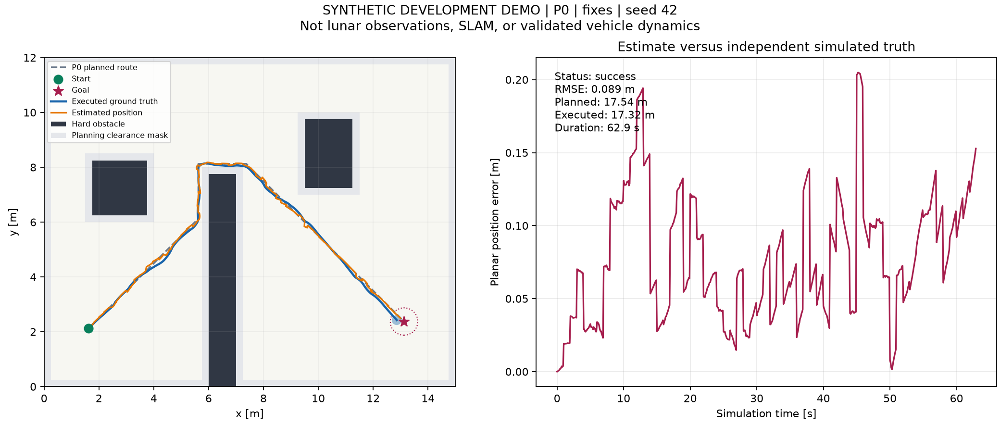

# Synthetic P0 example — seed 42

These three runs are development demonstrations, not final GNSS/SLAM experiments.

- `ideal/`: noise-free command-based odometry; mission succeeds.
- `odometry/`: configured synthetic noise/bias; execution stops before a collision.
- `fixes/`: same odometry model with noisy absolute position updates; mission succeeds.

Each directory contains full-rate CSV, scenario snapshot, metrics, figures, GIF and a checksum manifest. Source revision and its clean working-tree state are recorded in each manifest. GIFs are time-compressed previews.

Read [the Thai results note](../../docs/baseline-results.md) for metrics and interpretation limits. Compare multiple scenarios and seeds before making performance claims.

